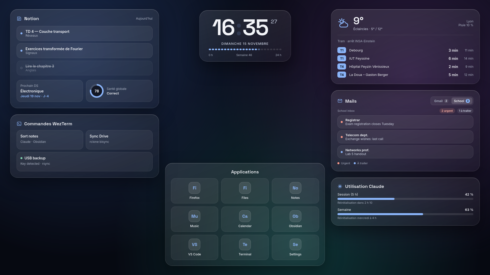
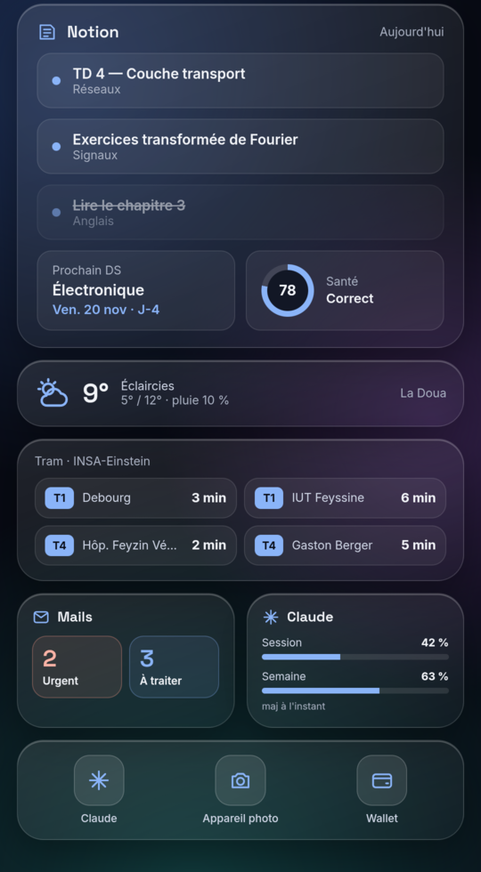

# NEXUS

**Your day at a glance, one shortcut away.** A full-screen glass dashboard for Fedora GNOME that sleeps until you call it.

[](LICENSE)
[](https://fedoraproject.org/workstation/)
[](https://v2.tauri.app/)
[](#android-app-optional)



*Screenshot with demo data. On open, the cards fly in from the screen edges; on close, they fly back out.*

## Features

- **Clock**: big time, date, 24-hour progress bar, ISO week.
- **App launcher**: a 3×3 grid of your apps with their real theme icons.
- **Command buttons**: open a WezTerm window running a command in your interactive shell. A button can depend on a path, such as a USB key, and turns on or off live as drives are mounted.
- **Weather** from Open-Meteo, no key needed.
- **Next departures**: real-time public transport. Lyon TCL is built in, and other networks can be added.
- **Notion**: today's tasks, next exam with a countdown, and a health score ring.
- **Mail**: Gmail labels and IMAP folders for "urgent" and "to do" mail, in tabs, read-only.
- **Claude usage**: 5-hour session and weekly quotas of your Claude plan.
- **Light on resources**: nothing refreshes while the dashboard is hidden. In our measurements it used about 150 MB of RAM and under 0.1 % CPU.
- **Your secrets stay in the GNOME keyring**, never in a file.
- **Optional Android app**: the same summary on your phone, through a relay you host on your own free Cloudflare account. No API key on the phone. See [Android app](#android-app-optional).

Every card is optional: remove its section from the config and it disappears.

## Installation (Fedora 44)

Download the `.rpm` from the [latest release](https://github.com/MaXelDev/nexus/releases/latest), then:

```bash
sudo dnf install ./nexus-*.x86_64.rpm
```

That's all. Press **Super+²** on an AZERTY keyboard (**Super+`** on QWERTY: the key above Tab) to show the dashboard, and **Escape** to close it. Launching an app or a command also closes it.

What the package does for you:

- **Starts NEXUS hidden** in your current session and at every login (`/etc/xdg/autostart/nexus.desktop`).
- **Creates the GNOME shortcut** on first start: Settings → Keyboard → Custom Shortcuts → NEXUS, which runs `nexus --toggle`. Wayland apps can't grab global keys, so GNOME runs this command for us. That key is GNOME's "switch windows of an app" by default; NEXUS takes the Super variant and leaves Alt+the same key alone. To use another key, change it in Settings. To stop NEXUS from creating it, set `shortcut = ""` in the config.
- **Works without a config file**: clock, a grid of stock Fedora apps and, if Claude Code is installed, its usage. Add the other cards in the config (below).

### Build from source

```bash
sudo dnf install webkit2gtk4.1-devel openssl-devel curl wget file \
  libappindicator-gtk3-devel librsvg2-devel libxdo-devel nodejs npm rpm-build
sudo dnf group install c-development
curl --proto '=https' --tlsv1.2 -sSf https://sh.rustup.rs | sh   # Rust via rustup
git clone https://github.com/MaXelDev/nexus && cd nexus
npm install
npm run tauri build    # → src-tauri/target/release/bundle/rpm/
```

Runtime tools are already on Fedora Workstation: `secret-tool` (libsecret), `gtk-launch` (GTK 3) and `xdg-open`. The command buttons use [WezTerm](https://wezfurlong.org/wezterm/).

## Configuration

```bash
mkdir -p ~/.config/nexus
cp config.example.toml ~/.config/nexus/config.toml   # then edit it
scripts/setup-secrets.sh                              # masked prompts, stored in the keyring
scripts/check-secrets.sh                              # one test call per service: OK / ERREUR
```

[`config.example.toml`](config.example.toml) documents every key. Config changes apply the next time the dashboard opens; changing `[[apps]]` needs a restart of NEXUS. The blurred wallpaper follows your GNOME wallpaper.

Secrets are stored with the attributes `service nexus key <name>`. To read one yourself, use `secret-tool lookup service nexus key notion_token`.

### Notion

1. Create an internal integration at <https://www.notion.so/profile/integrations> and copy its token. Store it with `scripts/setup-secrets.sh notion_token`.
2. On each database, open the **•••** menu, then **Connections**, and add your integration.
3. Under `[notion.tasks]` in the config, put the database id (the 32 hex characters in its URL) and your property names. They are case-sensitive.
4. Optional `[notion.health]`: the average of a number or formula property over the last 7 days.

### Gmail

1. In [Google Cloud Console](https://console.cloud.google.com/), create a project and enable the **Gmail API**.
2. Set up the OAuth consent screen as an *External* app in testing mode, and add your address as a test user.
3. Create an OAuth client of type **Desktop app**.
4. Store the client id and secret with `scripts/setup-secrets.sh gmail_client_id gmail_client_secret`.
5. Run `scripts/gmail-auth.py` once. It opens your browser, asks for read-only access, and stores the refresh token in the keyring.
6. In the config, set the label names of your "urgent" and "to do" mail.

### IMAP

Add a `[[mail]]` box with `kind = "imap"`, the host, the port (993 for implicit TLS) and the folder names. Credentials go in the keyring as `<secret_prefix>_user` and `<secret_prefix>_password`. NEXUS opens folders read-only and never marks mail as read.

### Public transport (Lyon TCL)

1. Create a free account on [data.grandlyon.com](https://data.grandlyon.com/).
2. Request access to the dataset **"Prochains passages du réseau TCL"**.
3. Store your account with `scripts/setup-secrets.sh grandlyon_user grandlyon_password`.
4. Find your stop ids, one per direction, in [`tcl_sytral.tclarret`](https://data.grandlyon.com/fr/datapusher/ws/rdata/tcl_sytral.tclarret/all.json).

### Weather

Open-Meteo needs no account. Set `latitude`, `longitude` and a place name under `[weather]`.

### Claude usage

The card reads the token Claude Code already stores in `~/.claude/.credentials.json` and never modifies it. It relies on an **undocumented** endpoint, so it may break; it then shows "Indisponible". The card is hidden when Claude Code is not installed.

## Real blur with Blur My Shell

Wayland does not let an app blur what is behind its window, so by default NEXUS draws your current wallpaper, blurred and darkened. For true blur of your open windows:

1. Install the [Blur my Shell](https://extensions.gnome.org/extension/3193/blur-my-shell/) extension.
2. Enable its **Applications** option for NEXUS.
3. Set `wallpaper_blur = false` in the config.

## Extending

- **Add an app**: add an `[[apps]]` entry with `desktop` set to the `.desktop` file name without extension (`ls /usr/share/applications ~/.local/share/applications`).
- **Add a command**: add a `[[commands]]` entry with `label`, `subtitle`, `command`, and optionally `cwd`, `requires_path` and `subtitle_unavailable`.
- **Add a transport network**: in `src-tauri/src/transport.rs`, write a `fetch_<provider>` function that returns `Vec<Departure>` and add it to the `match` in `fetch`. Then set `provider = "<name>"` in the config.
- **Add a mail provider**: add a variant to `MailKind` in `src-tauri/src/config.rs` and handle it in `src-tauri/src/mail.rs`.

## Android app (optional)



A one-screen companion for the phone: Notion, weather, trams, mail counts, Claude usage and three shortcuts, in the same glass style. Every block opens its app: Notion, the weather page, Gmail, Claude, the camera, Google Wallet. It never holds an API key: it talks to **nexus-relay**, a small Cloudflare Worker you deploy on your own free account, and stores a single read-only token.

```
Phone ──(1 revocable token)──▶ nexus-relay (Cloudflare Worker) ──▶ Notion, Gmail, IMAP, TCL, Open-Meteo, Claude quota
NEXUS PC ──(separate write token)──▶ nexus-relay  (sends the Claude quota)
```

- The token is encrypted with a key that never leaves the Android Keystore (StrongBox when available). Only Rust code reads it: the web page never sees it.
- No Google backup, no device-to-device transfer, HTTPS only, no screenshots of the settings screen. Permissions: Internet and camera (to scan the pairing QR), plus network state, which Google ML Kit (the QR reader) requires.
- Data refreshes when the app opens, when it comes back to the foreground, and when you pull down. It never refreshes in the background.
- Design and API: `docs/adr/0004`–`0007`, `docs/relay-api.md`. Mockup: `docs/maquette-android.html`.

<br clear="right">

### 1. Deploy the relay

You need a Cloudflare account (the free plan is enough) and NEXUS PC already configured. The IMAP counts come from another Worker of yours through a service binding: if you have none, delete the `[[services]]` block in `relay/wrangler.toml` first (Gmail counts still work).

```bash
cd relay && npm install && npx wrangler login && npx wrangler deploy && cd ..
scripts/relay-setup.sh      # PC tokens, copies of your keyring secrets, Gmail (labels only), config
```

Then add the relay to `~/.config/nexus/config.toml` and restart NEXUS:

```toml
[relay]
url = "https://nexus-relay.<you>.workers.dev"
```

The phone's buttons are set in an optional `[android]` section (`notion`, `mail`, `claude`, `wallet`: app package names; `weather_url`: a forecast page; `place`). Re-run `scripts/relay-setup.sh config` after any change.

### 2. Install the APK

Download `nexus-android-v*.apk` from the release and check its SHA-256. Then either:

- **USB**: enable USB debugging on the phone and run `adb install nexus-android-v*.apk`, or
- **File transfer**: copy the APK to the phone, open it, and allow "Install unknown apps" for your file manager when Android asks.

### 3. Pair the phone

1. On the PC, run `nexus --pair`. A QR code appears for 60 seconds.
2. On the phone, open NEXUS → **Réglages**, enter a name for the phone, then tap **Scanner le QR**.

The QR holds a one-time code, not a token: once it is used or expires, it is worthless.

### Lost or stolen phone

On the PC, list the paired phones, then revoke the lost one:

```bash
scripts/relay-revoke.sh                 # list paired phones
scripts/relay-revoke.sh "Galaxy S22"    # revoke it: its token is refused within a minute
```

That is all: the phone only had a read-only token, and no API key ever left Cloudflare. **Réglages → Oublier ce téléphone** does the same from the phone itself (for example before selling it).

### Build the APK yourself

You need JDK 21, the Android SDK (platform 36, build-tools 36) and NDK, and the Rust target `aarch64-linux-android`. `scripts/android-env.sh` assumes a user-level install (JDK in `~/.local/share/jdk`, SDK in `~/Android/Sdk`).

```bash
source scripts/android-env.sh
cd mobile && npx tauri android build --debug --apk --target aarch64   # debug build
scripts/android-release.sh                                            # signed release → dist/
```

`android-release.sh` signs with a key in `~/.config/nexus/android/nexus-release.p12`, whose password is in the GNOME keyring (`service nexus key android_keystore_password`). **Back up both**: without that key, you cannot update the installed app, only uninstall and reinstall it.

## Development

```bash
npm run tauri dev                          # window starts hidden
src-tauri/target/debug/nexus --toggle      # show / hide it
npm run dev                                # browser preview with demo data (no Tauri)
npm test                                   # frontend unit tests
cargo test --manifest-path src-tauri/Cargo.toml
```

## Troubleshooting

- **Blank or invisible window** (some GPU drivers): start NEXUS with `WEBKIT_DISABLE_DMABUF_RENDERER=1 nexus`.
- **A card says "indisponible"**: run `scripts/check-secrets.sh`, and start NEXUS from a terminal to see the error.
- **Keyring locked**: if you log in automatically, GNOME may not unlock the keyring, and cards that need secrets fail until you unlock it. Use the same password for the session and the keyring, or unlock it in Passwords and Keys (Seahorse).
- **App greyed out in the launcher**: its `.desktop` file was not found. NEXUS logs the name it looked for.
- **NEXUS shows in Alt+Tab**: GNOME on Wayland may ignore the "skip taskbar" hint.

## Uninstall

```bash
sudo dnf remove nexus
rm -rf ~/.config/nexus ~/.local/share/io.github.nexus.dashboard
for k in notion_token gmail_client_id gmail_client_secret gmail_refresh_token \
         zmail_user zmail_password grandlyon_user grandlyon_password; do
  secret-tool clear service nexus key "$k"
done
```

Then remove the NEXUS entry in Settings → Keyboard → Custom Shortcuts.

## Contributing

Issues and pull requests are welcome. Keep changes small, keep every card optional, and never put personal values or secrets in the repository. Run `npm test` and `cargo test` before opening a pull request.

## License

[MIT](LICENSE)

---

### En bref (français)

NEXUS est un tableau de bord plein écran pour Fedora GNOME (Wayland). Il reste caché et s'affiche avec un raccourci (Super+², la touche au-dessus de Tab, créé automatiquement).

Il regroupe l'horloge, vos applications, des commandes WezTerm, la météo, les prochains passages des transports, Notion, vos mails Gmail et IMAP, et votre quota Claude.

Les secrets restent dans le trousseau GNOME, et toute la configuration est dans `~/.config/nexus/config.toml`. Installation : `sudo dnf install ./nexus-*.rpm`, c'est tout.

Une appli Android (APK) optionnelle affiche le même résumé sur le téléphone via un relais Cloudflare personnel : aucune clé d'API sur le téléphone, un seul jeton en lecture seule, révocable avec `scripts/relay-revoke.sh` en cas de perte (voir « Android app »).
